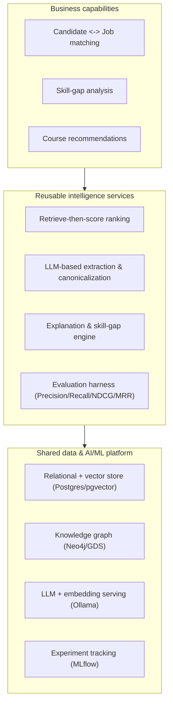
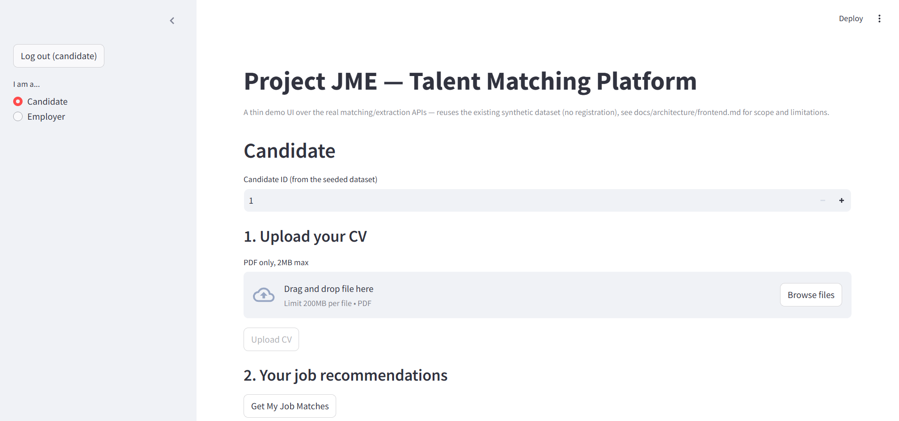
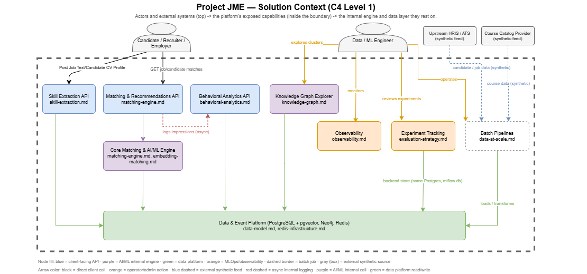

# JME — Enterprise AI Recommendation & Talent Intelligence Platform

An independently architected and engineered platform that connects business objectives to AI-driven recommendation capabilities through a shared data, AI/ML, and application architecture; demonstrated end to end on a talent-matching domain, with synthetic data and real, measured engineering evidence at every layer.

> **Scope note**: this repository implements a talent-matching platform. The architecture pattern behind it is a reusable recommendation and intelligence layer sitting on shared data and AI/ML services which is domain-agnostic. Section 12 describes where that pattern could extend; those extensions are **not implemented**.

---

## Table of contents

1. [Overview](#1-overview)
2. [Business context and architectural vision](#2-business-context-and-architectural-vision)
3. [Platform capabilities and implemented use cases](#3-platform-capabilities-and-implemented-use-cases)
4. [Enterprise solution architecture](#4-enterprise-solution-architecture)
5. [Architecture principles and key design decisions](#5-architecture-principles-and-key-design-decisions)
6. [Technology stack](#6-technology-stack)
7. [AI/ML engineering and recommendation approach](#7-aiml-engineering-and-recommendation-approach)
8. [Performance benchmarks and evaluation results](#8-performance-benchmarks-and-evaluation-results)
9. [Infrastructure, deployment and operational architecture](#9-infrastructure-deployment-and-operational-architecture)
10. [Security considerations and known limitations](#10-security-considerations-and-known-limitations)
11. [Extensibility and potential future applications](#11-extensibility-and-potential-future-applications)
12. [Getting started](#12-getting-started)
13. [Repository structure](#13-repository-structure)
14. [Detailed technical documentation](#14-detailed-technical-documentation)

---

## 1. Overview

JME takes a candidate or a job posting and returns ranked matches with an explanation of why each match was made, a rationale a human case worker could act on, not an opaque score. Around that core capability sits a full platform: skill extraction from free text, skill-gap analysis, course recommendations, semantic similarity via embeddings, and a knowledge graph for clustering, all backed by a real ingress/identity layer, a data platform, an MLOps loop, and an observability stack.

The purpose of this repository is broader than the talent-matching use case itself. It is a reference implementation of how I approach **enterprise AI platform architecture**: translating a business problem into a set of reusable capabilities, choosing the simplest sufficient technique before reaching for a more complex one, and backing every architectural claim with a real measurement rather than an assumption. Every number quoted in this README is reproducible from the commands in [Getting started](#12-getting-started) and documented in [`docs/`](docs/README.md).

The platform runs on entirely synthetic data generated by its own scripts. No confidential data, source code, schemas, or documents from any prior engagement were used or referenced. Every schema, scoring formula, and architectural decision here was designed from scratch for this project.

## 2. Business context and architectural vision

Organizations that place people into roles, workforce-development agencies, HR platforms, staffing providers, internal mobility teams, typically solve this with point solutions: one tool for matching, another for skills taxonomy, another for reporting, each with its own data model and its own AI integration. That pattern is common across enterprises generally: a product-recommendation team, a content-recommendation team, and a talent-matching team often rebuild the same retrieval, ranking, explanation, and evaluation logic independently, because nobody architected a shared layer underneath them.

JME is built the other way around. A **shared data and AI/ML foundation** (a relational + vector + graph data platform, a shared LLM/embedding serving layer, a shared evaluation harness) supports a **set of reusable recommendation and intelligence services** (retrieval, scoring, explanation, skill-gap/coverage analysis), which are in turn exposed through **standardized application interfaces** (versioned REST APIs behind a gateway, a thin demo UI) to the specific business capabilities this repository implements, candidate↔job matching, skill extraction, and course recommendations.



This is the architectural pattern this repository demonstrates: a business capability is an application built on reusable services, which are themselves built on a shared platform, not a single monolithic matching script. The pattern's applicability beyond talent intelligence is discussed in [Section 11](#11-extensibility-and-potential-future-applications), clearly separated from what is actually implemented today.

## 3. Platform capabilities and implemented use cases

| Capability | Status | Implementation |
|---|---|---|
| Candidate → job matching, ranked and explained | **Implemented** | Rule-based scoring (skill/location/salary/occupation) with embeddings-blended re-ranking as the default path |
| Job → candidate matching | **Implemented** | Same engine, inverse direction |
| Free-text skill extraction from job/CV text | **Implemented** | Hybrid LLM extraction + embedding-based canonicalization against a skill taxonomy |
| Skill-gap analysis | **Implemented** | Distinguishes "not recorded" from "assessed and absent"; part of every match result |
| Course / learning-path recommendations | **Implemented** | Rule-based coverage scoring against identified skill gaps |
| Semantic similarity / knowledge-graph clustering | **Partially implemented** | Job-to-job similarity via embeddings; candidate/job clustering via Neo4j + Graph Data Science (Louvain). No live similarity API beyond this. |

A thin Streamlit UI demonstrates both flows end to end (candidate uploads a CV and views matches; employer views candidate matches) through the real ingress chain and SSO login described below, not a mocked front end calling stubbed data.


<p align="center"><em>The candidate view, reached through the full Load Balancer → Reverse Proxy → SSO login chain described in Section 4.</em></p>

## 4. Enterprise solution architecture

Two C4-style diagrams anchor the design, generated directly from the running system:

**Solution context** (C4 Level 1) : who uses the platform and what it exposes to them:



**Technical architecture** (C4 Level 2) : every live service, data store, and AI/ML component, and how they connect:


<details>
<summary>Request flow through the platform (click to expand)</summary>

A candidate request for job matches travels: **Load Balancer → Reverse Proxy → API Gateway → matching API → {Postgres, Redis, Ollama embeddings}**, with a behavioral event published asynchronously via Redis Streams to the analytics service so the response path never blocks on it. A skill-extraction request follows the same ingress chain to the extraction service, which calls Ollama synchronously for LLM generation and per-phrase embedding canonicalization. Full runtime views: [`docs/architecture.md`](docs/architecture.md) §5.

</details>

Editable sources: [`docs/architect/JME_Solution_Context.drawio`](docs/architect/JME_Solution_Context.drawio), [`docs/architect/JME_Technical_Architecture.drawio`](docs/architect/JME_Technical_Architecture.drawio) (open in diagrams.net/VS Code). Each architecture layer also has its own Level-3 component diagram under [`docs/architecture/`](docs/architecture/) — see [Section 14](#14-detailed-technical-documentation).

## 5. Architecture principles and key design decisions

- **Simplest sufficient technique first, complexity only when measured as necessary.** The matching engine, skill-gap analysis, and course recommendations all shipped as deterministic, explainable baselines before any embeddings or graph model was introduced. Embeddings-blended ranking was only promoted to the default path after a controlled comparison showed it outperforming the rule-based baseline (NDCG@10 0.878 vs. 0.645 — see [Section 8](#8-performance-benchmarks-and-evaluation-results)).
- **Two-stage retrieve-then-score for anything at scale.** A pgvector approximate-nearest-neighbor index narrows a candidate/job population from potentially millions down to a few hundred plausible matches before the more expensive scoring logic runs. This pattern was validated at a synthetic scale of 1,000,000 candidates and 50,000 jobs, not assumed to hold.
- **Service boundaries follow bounded contexts, not file-system convenience.** The matching API, behavioral analytics service, and skill-extraction service are three independently deployable images, each with its own dependency manifest and, where it matters, its own schema, documented via [Architecture Decision Records](docs/adr/).
- **Every architectural claim is backed by a measurement.** Real load tests, real before/after latency numbers, and real defects found by running the system (a single-worker concurrency bottleneck, a multi-worker rate-limit counter-inflation bug, an N+1 query, an LLM-serving concurrency ceiling) are documented with their methodology, not asserted.
- **A real ingress and identity layer, not a diagram placeholder.** A Load Balancer, Reverse Proxy, and API Gateway (nginx) plus Keycloak-based OIDC SSO run as real containers handling real traffic, with round-robin balancing, routing, and the full login flow verified against the live stack.
- **Shared infrastructure, duplicated business logic.** Cross-cutting application code (rate limiting, dependency wiring) is deliberately duplicated per service to avoid coupling one service's Docker image to another's dependency surface. The one exception is structured logging, which has zero business logic and is shared on purpose; a documented, deliberate exception, not an inconsistency.

## 6. Technology stack

<details open>
<summary><strong>By architectural layer</strong></summary>

| Layer | Components |
|---|---|
| Ingress & identity | nginx (Load Balancer, 2× Reverse Proxy replicas, API Gateway); Keycloak (OIDC SSO) |
| Application layer | Streamlit (demo UI) |
| Application services | FastAPI matching engine (4 uvicorn workers); FastAPI behavioral analytics (Redis Streams consumer); FastAPI skill extraction |
| AI/ML serving | Ollama — `qwen2.5:1.5b` (generation), `nomic-embed-text` + `all-minilm` (embeddings) |
| MLOps | MLflow (experiment tracking, Postgres-backed) |
| Data platform | PostgreSQL 16 + pgvector (relational + vector ANN); Neo4j 5 + Graph Data Science (knowledge graph); Redis 7 (rate limiting, caching, Streams); SeaweedFS (S3-compatible object storage) |
| Observability | Prometheus + cAdvisor + Grafana (metrics); Loki + Promtail (centralized structured logging) |
| Batch / orchestration | Dockerized one-off jobs: migrations, seeding, data-quality checks, embedding computation, knowledge-graph sync/clustering, extraction evaluation |
| Deployment targets | Docker Compose (local); Kubernetes (local `kind` cluster, Kustomize); Azure-shaped Kustomize overlay (AKS/ACR/Azure Database for PostgreSQL/Azure Cache for Redis) |

</details>

## 7. AI/ML engineering and recommendation approach

**Retrieval and ranking.** Candidate/job matching uses a rule-based baseline (skill, location, salary, occupation alignment) as the explainable default, blended with embedding similarity once a candidate's embeddings exist. Embeddings are computed across three dimensions (skills, experience, overall) and stored in pgvector, with an HNSW index supporting the two-stage retrieve-then-score pattern described in [Section 5](#5-architecture-principles-and-key-design-decisions).

**Skill extraction.** A hybrid pipeline: an LLM call (`qwen2.5:1.5b` via Ollama) extracts candidate skill phrases from free text, each phrase is embedded and matched against a canonical skill taxonomy by similarity threshold. Model and threshold choices were made by measured comparison, not default settings, see [Section 8](#8-performance-benchmarks-and-evaluation-results).

**Evaluation discipline.** A dedicated evaluation harness (`app/evaluation/`) defines ground truth independently from the scoring formula under test, ranking quality is measured against occupation-alignment ground truth, not against the same blended formula being evaluated, specifically to avoid circular evaluation. Results (Precision@K, Recall@K, NDCG@K, MRR) are logged to MLflow for run-level comparison and to Postgres for per-candidate drill-down.

**Knowledge graph.** Neo4j with Graph Data Science mirrors the relational schema and runs native Louvain clustering, once over skills, once over candidates/jobs by shared-skill similarity to support the clustering half of semantic similarity (Section 3).

**Model-serving architecture.** All LLM/embedding inference is centralized behind a single Ollama service rather than loaded into each consumer, so a 1–3B-parameter model's fixed memory cost is paid once, not once per service. This is also where the platform's clearest known limitation lives — see [Section 8](#8-performance-benchmarks-and-evaluation-results) and [Section 10](#10-security-considerations-and-known-limitations).

## 8. Performance benchmarks and evaluation results

All numbers below are real measurements with a documented methodology — see [`docs/operations/production-readiness.md`](docs/operations/production-readiness.md), [`docs/architecture/data-platform/data-at-scale.md`](docs/architecture/data-platform/data-at-scale.md), and [`docs/operations/capacity-planning.md`](docs/operations/capacity-planning.md) for full detail and raw output.

| Metric | Result |
|---|---|
| Matching API, single-request latency | ~0.3s |
| Matching API, p95 @ 20 concurrent requests | 0.57s (was 1.84s before fixing a single-worker-process bottleneck) |
| Matching API, throughput | 56.1 req/s at 4 uvicorn workers (up from 14.2 req/s at 1 worker) |
| Matching API, 6-minute soak test | Stable p50 ~0.17–0.18s, no degradation over the run |
| Synthetic scale test | 1,000,000 candidates / 50,000 jobs generated and exercised end to end (Postgres bulk-load ~11m40s, Neo4j graph sync ~15m50s) |
| Matching quality (NDCG@10) | Rule-based baseline 0.645 → embeddings-blended 0.878 (now the default ranking path) |
| Skill extraction quality (F1) | Baseline 0.504 (untuned) → 0.60–0.68 across tuned runs (model switched to `qwen2.5:1.5b`); most recent re-run on updated synthetic data: 0.6766 |
| LLM/embedding path under concurrency | Throughput **0.28 → 0.16 req/s** and p95 latency **~18s → ~58s** as concurrent requests rose from 3 to 6 against the single Ollama instance — see Known Limitations |

<details>
<summary>Why the skill-extraction F1 is a range, not one number (click to expand)</summary>

Skill-extraction quality is reported across a range (0.60–0.68) rather than a single figure because the LLM is not run at temperature 0 — repeated evaluation runs on the same golden dataset produce slightly different F1 scores from normal generation variance. This is reported as a range deliberately, not rounded to a single reassuring number.

</details>

## 9. Infrastructure, deployment and operational architecture

| Target | Status |
|---|---|
| Docker Compose (local) | **Verified end to end**, the authoritative local deployment manifest; all always-on services plus profiled one-off batch jobs |
| Kubernetes, local `kind` cluster | **Verified end to end for the matching API** (Deployment, Service, HorizontalPodAutoscaler, 2–5 replicas). Other services currently have no complete Deployment/Service/HPA manifests; this is a documented gap, not an oversight |
| Azure-shaped Kustomize overlay | **Designed, not deployed.** Produces AKS/ACR/Azure Database for PostgreSQL/Azure Cache for Redis/Application Gateway Ingress-shaped manifests; never run against a real Azure subscription (a deliberate zero-cloud-cost choice) |
| Offline / air-gapped deployment | **Verified end to end** with zero network access |

**Observability**: Prometheus + cAdvisor + Grafana for metrics, Loki + Promtail for centralized structured JSON logging across every always-on service (batch jobs not yet included, see below).

**CI/CD**: automated lint, test, and build on every change, including a fresh-volume smoke test and live-service checks (ingress round-robin, SSO token exchange, log ingestion).

**Backup/recovery**: `pg_dump`/`pg_restore` scripts with a verified restore cycle; equivalent backup/restore scripts for the Ollama model cache, since re-pulling multi-gigabyte model weights is expensive to repeat.

## 10. Security considerations and known limitations

This platform is explicitly **not** positioned as production-deployed or enterprise-hardened. The following are documented, not hidden:

- No TLS anywhere in the stack yet.
- No secrets manager, configuration is via `.env` files and Kubernetes `Secret` placeholders.
- No multi-tenant authorization model. Service-to-service calls use a single static API key; human access to the demo UI is separately gated by Keycloak OIDC SSO, two independent mechanisms, not a layered permission model.
- **The LLM/embedding serving layer (Ollama) is a measured, unresolved concurrency bottleneck.** A single CPU-only instance with no `OLLAMA_NUM_PARALLEL` tuning serializes inference; real concurrent load testing showed throughput dropping and tail latency approaching the request timeout as concurrent load increased (see [Section 8](#8-performance-benchmarks-and-evaluation-results)). The architectural remedy (GPU-backed inference, multiple replicas, or a request queue) is documented, not implemented.
- **Embedding computation has no live HTTP endpoint.** Embeddings are computed by a batch job (`embeddings-compute`), not exposed as an on-demand service — there is no "concurrent users calling an embeddings API" scenario to measure today, a documented gap in the platform's surface area.
- The behavioral-analytics and skill-extraction services each run a single application-server worker; only the matching API has the multi-worker configuration its own load test showed was necessary.
- Batch jobs are not yet wired into the centralized structured-logging pipeline.
- Postgres connection-pool headroom is real but bounded: the default `max_connections=100` against application services' combined SQLAlchemy pools leaves limited room before a connection pooler or a higher limit is required.

Full detail: [`docs/security-and-threat-model.md`](docs/security-and-threat-model.md), [`docs/assumptions-register.md`](docs/assumptions-register.md), [`docs/operations/production-readiness.md`](docs/operations/production-readiness.md).

## 11. Extensibility and potential future applications

The architecture pattern described in [Section 2](#2-business-context-and-architectural-vision), shared data/AI platform → reusable retrieval/ranking/explanation services → business-specific applications is not inherently limited to talent matching. The same retrieve-then-score, embedding-blended ranking, and evaluation-harness pattern would apply with a different entity model and embedding space to:

- Internal workforce mobility and employee-to-role matching.
- Skills-to-learning and training-path recommendations (a direct extension of the existing course-recommendation capability).
- Product-to-customer or service-to-customer recommendations.
- Resource and opportunity allocation problems with a similar retrieve-then-rank shape.
- Other semantic matching, ranking, or personalization use cases built on embeddings and a knowledge graph.

**None of these extensions are implemented in this repository.** They are stated here as the natural reach of the architecture, not as delivered functionality, a distinction this project treats as important enough to say explicitly rather than imply.

## 12. Getting started

```sh
cp .env.example .env
docker compose up -d --build
docker compose run --rm migrate
docker compose run --rm seed
docker compose run --rm ollama-pull   # pulls the LLM/embedding models used by extraction
```

| Endpoint | URL | Notes |
|---|---|---|
| Application entry point | `http://localhost:8080` | Load Balancer — the real public entry point; redirects to Keycloak login |
| Grafana (metrics + logs) | `http://localhost:3000` | Anonymous viewer access enabled locally |
| MLflow | `http://localhost:5000` | Experiment tracking |
| Neo4j Browser | `http://localhost:7474` | Knowledge graph |

Seeded Keycloak test users and the full login flow: [`docs/architecture/ingress-and-identity.md`](docs/architecture/ingress-and-identity.md). Kubernetes and offline deployment paths, plus every batch job: [`docs/README.md`](docs/README.md).

## 13. Repository structure

<details>
<summary><strong>Top-level layout (click to expand)</strong></summary>

```
app/            FastAPI services, Streamlit frontend, batch jobs, shared logging package
docker/         Dockerfiles and per-service config (nginx, Keycloak, Loki/Promtail, Grafana, Prometheus)
docs/           Architecture docs by layer (docs/architecture/), operations docs (docs/operations/),
                ADRs (docs/adr/), architecture diagrams (docs/architect/)
k8s/            Kustomize base manifests and local/Azure-shaped overlays
alembic/        Database migrations
tests/          Unit tests and real-transaction database tests
scripts/        Load testing, backup/restore, offline-bundle packaging
```

</details>

## 14. Detailed technical documentation

Documentation is organized by architecture layer under [`docs/architecture/`](docs/README.md#architecture-layers-docsarchitecture), each layer has its own Level-3 component diagram and, where warranted, Level-4 per-container deep dives, plus [`docs/operations/`](docs/README.md#operations-docsoperations) for deployment/operational concerns and [`docs/adr/`](docs/adr/) for architecture decision records. Start here:

- [`docs/README.md`](docs/README.md) : full documentation index
- [`docs/architecture.md`](docs/architecture.md) : consolidated arc42-style system view
- [`docs/prd.md`](docs/prd.md) : product requirements and use cases
- [`docs/assumptions-register.md`](docs/assumptions-register.md) : every assumption made, why, and what would invalidate it
- [`docs/operations/production-readiness.md`](docs/operations/production-readiness.md) : an honest gap assessment against the project's own Definition of Done
- [`docs/operations/capacity-planning.md`](docs/operations/capacity-planning.md) : the concurrent-user scaling story across every layer, including the LLM-serving bottleneck
- [`docs/security-and-threat-model.md`](docs/security-and-threat-model.md) : authentication/authorization approach and gaps
