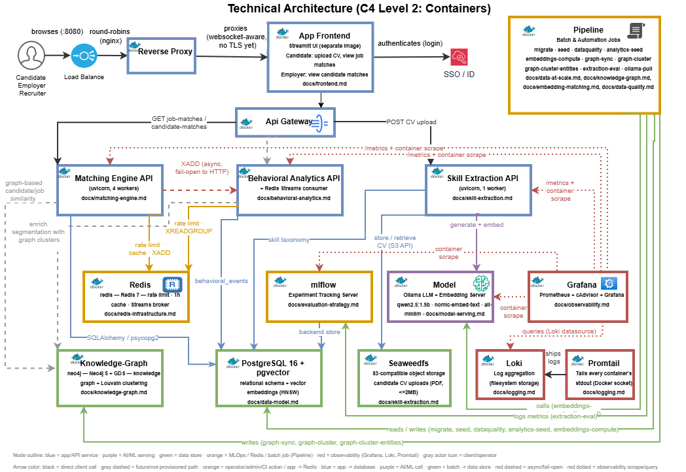

# Project JME - Job Matching & Talent Intelligence Platform

Project JME is a talent-matching platform. It takes a candidate or a job posting and returns ranked matches, with a plain-language explanation of why each match was made. The goal is a real rationale a human case worker could act on, not just a score.

I built this project on my own, from scratch, as a portfolio piece. It shows how I design, build, measure, secure, and run a real system end to end, as an AI Architect / Platform Architect would. I use rule-based logic first and add machine learning only where it earns its place. Every architecture decision below is backed by a real measurement, and every known gap is written down instead of hidden.

Organizations that place people into jobs, such as workforce-development agencies, HR platforms, and staffing providers, need to match people to opportunities at scale, explain why a match happened, find skill gaps, and suggest ways to close them, all in a way that can be audited later. This project builds that kind of system from the ground up: synthetic data, open-source tools, and 30 phases of work, each one verified before moving to the next. It serves as a working case study and as hands-on preparation for AI Architect / AI Platform Architect interviews.

This is an independent project, not a copy of any employer's system. No confidential data, source code, schemas, or internal documents from any prior job were used or referenced. All data is synthetic and generated by this project's own scripts. All schemas, scoring logic, and architecture were designed from scratch for this project.

## What it does

| Use case | Status |
|---|---|
| Candidate to job matching, ranked and explained | Built, rule-based with embeddings blended in (default) |
| Job to candidate matching | Built, same engine, other direction |
| Free-text skill extraction from job or CV text | Built, hybrid LLM extraction plus embedding canonicalization |
| Skill-gap analysis ("not recorded" vs. "assessed and absent") | Built, part of every match result |
| Course and learning-path recommendations | Built, rule-based coverage scoring |
| Similarity and semantic search | Partial, job similarity via embeddings; candidate/job clustering via a knowledge graph |

There is also a small Streamlit demo UI. A candidate can upload a CV and see job matches, and an employer can see candidate matches. Both call the same real APIs described below, through a real login gate and a real ingress chain (see Architecture).

## Architecture

Two diagrams anchor the design. Both are built from the real running system, not mockups. Full detail is in [docs/architecture.md](docs/architecture.md).



- [docs/architect/JME_Solution_Context.drawio](docs/architect/JME_Solution_Context.drawio) shows who uses the system and what it exposes to them (C4 Level 1).
- [docs/architect/JME_Technical_Architecture.drawio](docs/architect/JME_Technical_Architecture.drawio) shows every live service, data store, and AI/ML component, and how they connect (C4 Level 2).

A few decisions shaped most of the work:

- Rule-based logic came first, every time. The matching engine, skill-gap analysis, and course recommendations all shipped as plain, explainable baselines before any machine learning was added. Embeddings and a knowledge graph were only added once there was a measured reason for them. Embeddings-blended ranking became the default only after testing showed it was actually better (NDCG@10 0.878 vs. 0.645 for the rule-based version).
- Matching at scale works in two steps. A pgvector index first narrows thousands or millions of candidates and jobs down to a few hundred plausible ones, and only then does the more expensive scoring run. This was stress-tested for real at 1 million candidates and 50,000 jobs, not just assumed to work.
- Services are split by business area, not by convenience. The matching API, the behavioral analytics service, and the skill-extraction service are each independently deployable, with their own dependencies, instead of one shared monolith split into folders. The reasoning is written down in [docs/adr/](docs/adr/).
- Every claim here is backed by a real test. Real stress tests, real before/after latency numbers, and real bugs found by running the code, including a rate-limiting bug, a slow database query, and a timezone bug, are documented rather than just claimed.
- The ingress and identity layer is real, not just a diagram. A Load Balancer, a Reverse Proxy, and an API Gateway (all nginx) plus a Keycloak-based SSO login sit in front of the app as real containers handling real traffic. Round-robin load balancing, routing, and the full login flow were all verified against the running stack. See [docs/ingress-layer.md](docs/ingress-layer.md) and [docs/sso.md](docs/sso.md).

### Building blocks

| Layer | Components |
|---|---|
| Ingress and identity | nginx Load Balancer, Reverse Proxy, API Gateway; Keycloak (OIDC SSO) |
| Demo frontend | Streamlit (candidate CV upload and job matches; employer candidate matches) |
| Application services | FastAPI matching engine (4 workers); behavioral analytics (event ingestion plus a Redis Streams consumer); skill extraction |
| AI/ML serving | Ollama (qwen2.5:1.5b for generation; nomic-embed-text and all-minilm for embeddings) |
| Data platform | PostgreSQL 16 with pgvector; Neo4j 5 with GDS (knowledge graph); Redis 7 (rate limiting, caching, streams); SeaweedFS (S3-compatible CV storage) |
| MLOps | MLflow (experiment tracking) |
| Observability | Prometheus, cAdvisor, and Grafana (metrics); Loki and Promtail (centralized logging) |
| Batch jobs | migrations, seeding, data-quality checks, embedding computation, knowledge-graph sync and clustering, extraction evaluation |

### Measured results

These numbers come from real tests, not estimates.

| Quality attribute | Measured |
|---|---|
| Single-request latency | about 0.3s |
| p95 latency under load (20 concurrent requests) | 0.57s (was 1.84s before fixing a single-worker bottleneck) |
| Throughput under load | 56.1 requests/sec at 4 workers (up from 14.2 at 1 worker) |
| Sustained load (6-minute soak test) | steady p50 of about 0.17 to 0.18s, no slowdown over time |
| Scale target | 1 million candidates and 50,000 jobs, generated and stress-tested for real |
| Matching quality (NDCG@10) | rule-based 0.645, embeddings-blended 0.878 (now the default) |

Full methodology and raw numbers are in [docs/production-readiness.md](docs/production-readiness.md) and [docs/data-at-scale.md](docs/data-at-scale.md).

## Getting started

```sh
cp .env.example .env
docker compose up -d --build
docker compose run --rm migrate
docker compose run --rm seed
```

Then open `http://localhost:8080`. That is the Load Balancer, the real public entry point (see [docs/ingress-layer.md](docs/ingress-layer.md)). Log in with one of the seeded Keycloak test users (see [docs/sso.md](docs/sso.md)). Grafana, for metrics and logs, is at `http://localhost:3000`. MLflow is at `http://localhost:5000`. For full setup, including the batch jobs and the Kubernetes and offline deployment paths, see [docs/README.md](docs/README.md).

## Repository layout

```
app/            FastAPI services, Streamlit frontend, batch jobs, shared logging package
docker/         Dockerfiles and per-service config (nginx, Keycloak, Loki/Promtail, Grafana, Prometheus)
docs/           Every design and verification doc, ADRs, architecture diagrams
k8s/            Kustomize base and local/Azure-shaped overlays (verified on a local kind cluster)
alembic/        Database migrations
tests/          Unit and real-transaction database tests
scripts/        Load testing, backup/restore, offline-bundle packaging
```

## Documentation

This README is the top-level summary. Every subsystem has its own doc under [docs/](docs/README.md). Each one follows the same structure (purpose and scope, architecture and design, implementation, verification and results, known limitations, roadmap), so any doc can be read the same way no matter when it was written. Good places to start:

- [docs/prd.md](docs/prd.md): the full product brief and use cases
- [docs/architecture.md](docs/architecture.md): the consolidated system view
- [docs/progress.md](docs/progress.md): the full, honest, phase-by-phase build log
- [docs/assumptions-register.md](docs/assumptions-register.md): every assumption made, why, and what would prove it wrong
- [docs/production-readiness.md](docs/production-readiness.md): what is genuinely production-ready today, and what is an explicit, documented gap

## Status

All 30 phases are complete. The system runs end to end locally through Docker Compose. A Kubernetes deployment has been verified on a local cluster, and an Azure-shaped overlay has been written but never run against a real cloud subscription. That is a deliberate, documented choice, not an oversight. Known gaps, such as no TLS, no secrets manager, no multi-tenant authorization, and batch jobs not yet using structured logging, are tracked openly rather than hidden. See [docs/security-and-threat-model.md](docs/security-and-threat-model.md) and [docs/assumptions-register.md](docs/assumptions-register.md).
