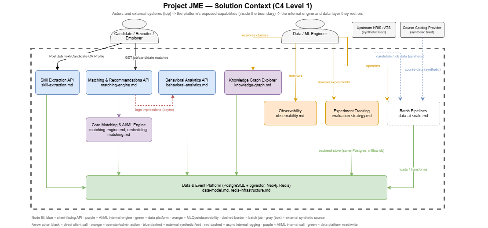

# Architecture Overview

One consolidated, arc42-shaped view of Project JME — the "start here" document for understanding
how the whole system fits together. It links out to the deep-dive doc for anything it summarizes
rather than duplicating it (see `docs/README.md`'s "Why consolidated, not one file per brief
bullet"); this document's own job is synthesis, not new content.

Two diagrams anchor this document, built fresh from the real implemented system (not mockups):
- [`docs/architect/JME_Solution_Context.drawio`](architect/JME_Solution_Context.drawio) — who uses
  this system and what it exposes to them. Rendered below (exported directly from the `.drawio`
  source — open that file in diagrams.net/VS Code to edit it).

  
- [`docs/architect/JME_Technical_Architecture.drawio`](architect/JME_Technical_Architecture.drawio)
  — every live service, data store, and AI/ML component, and how they connect.

## 1. Introduction and goals

Project JME is an end-to-end AI-architecture portfolio project: a talent-matching platform built to
demonstrate how a real system gets designed, built, measured, and hardened — not a toy demo. The
brief (`docs/prd.md`) frames six use cases (A–F below); the engineering discipline threaded through
every phase (`docs/progress.md`) is **rule-based-first, then measure before adding complexity**
(assumption A5) — embeddings, a knowledge graph, and Redis were each added only once a documented,
scoped need existed, not speculatively.

| ID | Use case | Status |
|---|---|---|
| A | Candidate → job matching | Built — rule-based + embeddings-blended (default), explained, cached |
| B | Job → candidate matching | Built — same engine, inverse direction |
| C | Free-text skill extraction | Built — hybrid LLM extraction + embedding canonicalization, plus basic CV upload storage (PDF, 2MB cap) |
| D | Skill-gap analysis | Built — part of every match result (A/B) |
| E | Course recommendations | Built — rule-based coverage scoring |
| F | Similarity / semantic search | Partially built — job similarity via embeddings (A/B); candidate/job clustering via the knowledge graph (Phase 23) |

## 2. System scope and context

See the Solution Context diagram. Three human actor types (candidate, employer/recruiter, data/ML
engineer) interact with the platform's exposed capabilities; two upstream sources (an HRIS/ATS feed
and a course catalog, both synthetic) represent what a real integration would look like. The
platform itself is a single Docker Compose stack locally, with a documented (not provisioned)
Kubernetes/AKS-shaped deployment target (`docs/kubernetes.md`).

**Explicitly out of scope** (`docs/prd.md` §6): a public self-service portal, real candidate PII,
multi-agent orchestration frameworks, and any confidential prior-employer material — a standing
constraint maintained by discipline throughout (assumption A8).

## 3. Solution strategy — the decisions that shaped everything else

- **Rule-based before ML, every time** (A5): the matching engine, skill-gap analysis, and course
  recommendations all shipped as deterministic, explainable baselines first. Embeddings (Phase 17)
  and the knowledge graph (Phase 19) were added only once each had a measured case, and Phase 22
  only promoted embeddings-blended ranking to the default after re-verification showed it winning
  (NDCG 0.878 vs. 0.645) — see `docs/embedding-matching.md`.
- **Two-stage retrieve-then-score for anything at scale** (Phase 17): pgvector's ANN index narrows
  thousands-to-millions of candidates/jobs to a few hundred plausible ones before any expensive
  scoring runs — the architectural pattern that makes 1M-candidate/50K-job scale tractable at all
  (`docs/data-at-scale.md`).
- **Service boundaries follow bounded contexts, not convenience**: `api` (matching), `analytics`
  (behavioral events), and `extraction` (skill parsing) are independently deployable images with
  their own requirements files and, where it matters, their own database schema — not one monolith
  split by folder. Three ADRs and every phase's "service boundary" section document this
  discipline directly (e.g. `docs/adr/0001-decouple-ingestion-migrate-api.md`).
- **Redis only for three scoped, measured use cases** (Phase 21/25), not "add Redis" as a
  capability: a rate-limiting store fixing a measured multi-worker bug, a 1-hour result cache with
  active invalidation on the one real mutation path, and a Streams-based decoupling of an
  instrumentation hook, with retry/dead-letter handling verified against a deliberately simulated
  consumer crash — `docs/redis-infrastructure.md`.
- **Every claim is measured, not assumed** — the single discipline that recurs most across
  `docs/progress.md`: real stress tests (1M candidates/50K jobs), real before/after latency numbers,
  real bugs found by running code rather than reading it (the Phase 20 N+1, the Phase 24 naive-
  datetime bug), real clustering purity numbers instead of an assumed "it probably works."

## 4. Building block view

See the Technical Architecture diagram for the full picture. By layer:

| Layer | Components | Doc |
|---|---|---|
| Application services | `api` (matching engine, 4 workers), `analytics` (event ingestion + Streams consumer), `extraction` (skill parsing) | `docs/matching-engine.md`, `docs/behavioral-analytics.md`, `docs/skill-extraction.md` |
| AI/ML serving | `ollama` (qwen2.5:1.5b generation; nomic-embed-text, all-minilm embeddings) | `docs/model-serving.md` |
| Data platform | PostgreSQL 16 + pgvector (relational + vector), Neo4j 5 + GDS (knowledge graph), Redis 7 (rate limit/cache/streams), SeaweedFS (S3-compatible object storage for CV uploads) | `docs/data-model.md`, `docs/knowledge-graph.md`, `docs/redis-infrastructure.md`, `docs/skill-extraction.md` |
| MLOps | MLflow (experiment tracking, its own Postgres-backed store) | `docs/evaluation-strategy.md` |
| Observability | Prometheus, cAdvisor, Grafana | `docs/observability.md` |
| Batch/one-off jobs | `migrate`, `seed`, `dataquality`, `analytics-seed`, `embeddings-compute`, `graph-sync`, `graph-cluster`, `graph-cluster-entities`, `extraction-eval`, `ollama-pull` | each phase's own doc |

## 5. Runtime view — three representative flows

**A. A candidate requests job matches** (`GET /candidates/{id}/job-matches`): `api` checks the
version-stamped Redis cache first (`X-Cache` header reports hit/miss); on a miss, it scores every
eligible job rule-based (skill/location/salary/occupation + skill-gap), then — by default — re-ranks
that pool using the Phase 17 embeddings-blended score if the candidate has embeddings computed
(`X-Ranking-Mode` reports which path ran), writes the result back to Redis with a 1-hour TTL, and
publishes a `recommendation_shown` event via Redis Streams (`XADD`) for the analytics service to
pick up asynchronously — a real matching response never blocks on analytics being up.

**B. A candidate's embeddings get recomputed** (`embeddings-compute`, a batch job): checks each
dimension's content hash against what's stored, recomputes only what's stale, and — the moment a
candidate's embeddings change — bumps their Redis cache-version key (`app/embeddings/
cache_invalidation.py`), making any cached ranking for them unreachable immediately rather than
waiting out the TTL.

**C. The knowledge graph gets rebuilt** (`graph-sync` then `graph-cluster`/`graph-cluster-entities`):
an idempotent batch ETL mirrors every relational entity/junction table into Neo4j, then native-GDS
Louvain clustering runs entirely in Cypher — once over skills (Phase 19) and once over
candidates/jobs by shared-skill similarity (Phase 23) — writing `communityId` back onto the graph,
browsable in Neo4j Browser.

## 6. Deployment view

Local: Docker Compose, one `name: jme` project, always-on services plus profiled one-off jobs — see
`docker-compose.yml` directly, it's the authoritative deployment manifest for local dev.
Kubernetes: verified end-to-end on a local `kind` cluster (`docs/kubernetes.md`), with a
`kustomize` overlay that produces valid Azure-shaped manifests (AKS pods, Azure Database for
PostgreSQL, Azure Cache for Redis, ACR, AGIC ingress) — generated and reviewed, never `kubectl
apply`'d against a real Azure subscription (assumption A1), an honest "designed, not provisioned"
line this project has held since Phase 11.

## 7. Cross-cutting concepts

- **AuthN/Z**: a single static API key per service (`X-API-Key`), documented as the honest MVP for
  a single-tenant project, not a production-grade model — `docs/security-and-threat-model.md`.
- **Rate limiting**: `slowapi`/`limits`, Redis-backed for `api`/`analytics` (fixing a real measured
  multi-worker bug), in-memory for single-worker `extraction`.
- **Observability**: Prometheus scrapes every service's `/metrics` plus cAdvisor's container-level
  CPU/RAM; Grafana visualizes it — `docs/observability.md`.
- **Data quality**: an automated report (orphaned FKs, duplicate near-misses, missing fields) run
  after every seed — `docs/data-quality.md`.
- **Testing discipline**: pure-logic unit tests plus real-transaction-wrapped DB tests (rolled back,
  never touching the real seeded dataset) for anything that queries Postgres; `docker compose`
  smoke tests in CI for anything that needs the full running stack.

## 8. Architecture decisions

`docs/assumptions-register.md` tracks every assumption made, why, and what would invalidate it —
the running decision log for this project. Larger, discrete decisions get their own ADR under
`docs/adr/` (e.g. `0001-decouple-ingestion-migrate-api.md`).

## 9. Quality requirements — measured, not aspirational

| Quality attribute | Target | Measured | Source |
|---|---|---|---|
| Single-request latency | Fast enough for interactive use | ~0.3s | `docs/production-readiness.md` |
| p95 latency under load (20 concurrent) | Bounded, not degrading linearly | 0.57s (after fixing a single-worker bottleneck; was 1.84s) | `docs/production-readiness.md` |
| Throughput under load | Scale with workers, not plateau | 56.1 req/s (4 workers, up from 14.2 req/s at 1) | `docs/production-readiness.md` |
| Sustained load (soak) | No degradation over time | Stable p50 ~0.17-0.18s across a 6-minute soak | `docs/production-readiness.md` |
| Scale target | 1M candidates / 50K jobs | Generated and stress-tested for real: Postgres load 11m40s, Neo4j graph sync 15m50s | `docs/data-at-scale.md` |
| Rate-limit accuracy under multi-worker load | A true global limit | Fixed from ~122-through to a clean 100/50 split | `docs/redis-infrastructure.md` |
| Matching quality (NDCG@10) | Beat a naive baseline | Rule-based 0.645, blended 0.878 (now default) | `docs/embedding-matching.md` |

## 10. Risks and technical debt (summarized, not hidden)

- No real secrets manager, TLS, or multi-tenant authN/authZ — explicit, documented local-only
  placeholders (assumptions A7/A9).
- Single Redis instance, no HA; cache invalidation only covers the one mutation path that exists
  today (embeddings recompute) — there is still no candidate/job profile mutation API.
- No kubelet-cadvisor RBAC scraping in the Kubernetes deployment; HPA is visible but inert without
  `metrics-server`.
- Candidate/job embeddings and extraction are computed at a sampled scale, not the full 1M/50K
  population, by design (`docs/data-at-scale.md`).

Full "what's still missing for real production use" accounting: `docs/production-readiness.md`.

## 11. Glossary

- **Blended ranking**: the Phase 17 embeddings score combined with rule-based location/salary/
  occupation components — the default ranking path for Use Case A/B since Phase 22.
- **Stage-1/stage-2 retrieval**: the two-stage retrieve-then-score pattern (ANN narrows, then full
  scoring runs only on the narrowed set).
- **Domain-anchored sampling**: the Phase 20 synthetic-data fix that groups skills into 4 coarse
  domains and anchors each occupation's skill profile to one, giving the knowledge graph real
  clustering signal.
- **Fail-open**: a design discipline used throughout (analytics instrumentation, Redis caching,
  Redis Streams) where an external dependency being unavailable degrades behavior gracefully
  instead of breaking the caller.
