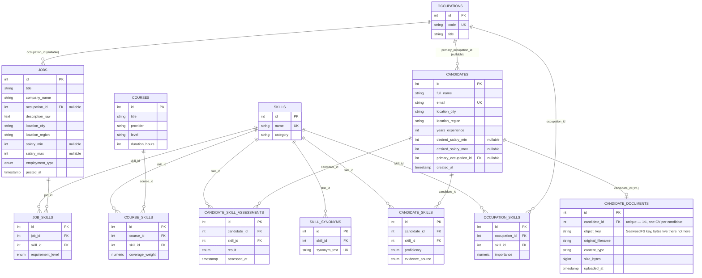
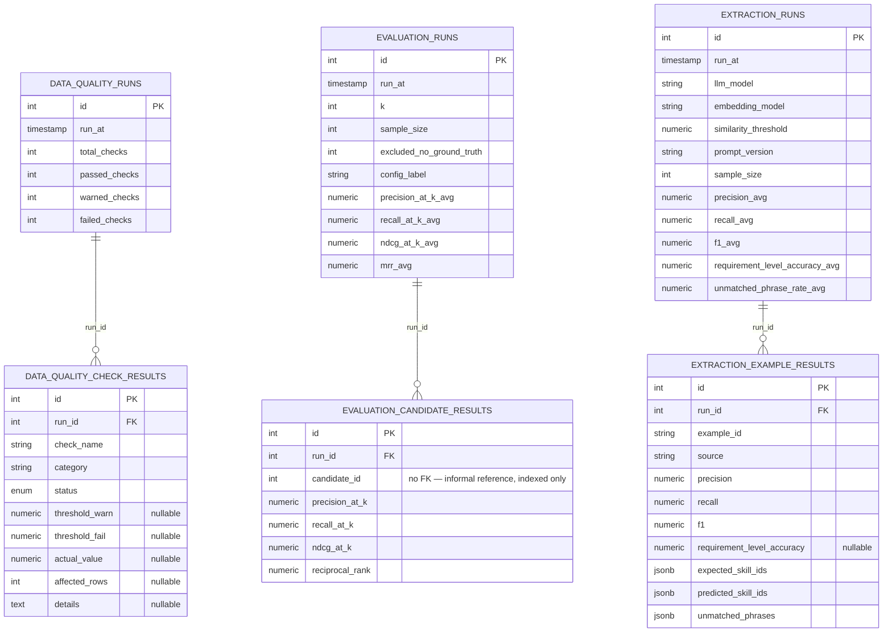
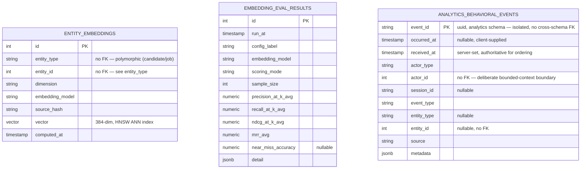

# Data Model

Status: v0.2, implemented and verified. Schema lives in `app/ingestion/source_models.py`, managed via Alembic (`alembic/versions/`). Generator: `app/ingestion/generate_synthetic_data.py` (paths updated after the Phase 2 follow-up restructuring into `app/ingestion/`/`app/api/`).

## Purpose & Scope

Defines the relational schema underlying the whole platform: the canonical skill/occupation/course taxonomy, candidate and job entities, and the junction tables connecting them. Scope covers schema design, synthetic data generation, and the deliberate imperfections that keep the dataset realistic.

## Architecture & Design

### Entity-relationship diagrams (full schema, split by cluster for readability)

The master schema reference for the data-engineering team: every table the platform defines, with primary/foreign/unique keys. Covers more than this doc's own core-domain scope (below) deliberately, each governance/ML/analytics table is detailed in its owning service's doc, but the relationships between all of them only make sense drawn together once.

#### Core domain taxonomy, candidates, jobs

The one fully-connected graph: skills/occupations/courses taxonomy, candidates, jobs, and the
join tables between them. 12 tables.

#### Governance & ML run tracking

Three independent run/result pairs, each is self-contained (a `*_runs` header row linked only to its own detail rows) and not connected to each other or to the core domain by any FK. 6 tables.

#### Standalone & cross-cutting tables (no FK constraints)

Three tables with zero FK-constrained relationships to anything else in the schema, each is deliberately decoupled (polymorphic, append-only, or a separate Postgres schema), not an oversight. See the callouts just below for exactly why each one has no drawn relationship.

**Intentionally not drawn as FK-backed relationships above** (real in the data, but enforced in application code / a data-quality check, not a database constraint, each is a deliberate bounded- context or polymorphism choice, not an oversight):
- `ENTITY_EMBEDDINGS.entity_id` → `CANDIDATES.id` / `JOBS.id`, selected by `entity_type`, pgvector's fixed-width column means one physical table backs multiple logical entity types.
- `EVALUATION_CANDIDATE_RESULTS.candidate_id` → `CANDIDATES.id`, indexed but not FK-constrained.
- `ANALYTICS_BEHAVIORAL_EVENTS.actor_id` / `.entity_id` → `CANDIDATES.id` / `JOBS.id`, a separate Postgres **schema** (`analytics`, not `public`) by design, so its migrations stay independent of the matching engine's; referential integrity here is a data-quality report, not a constraint. See [behavioral-analytics.md](../application-services/behavioral-analytics.md) "Service boundary".

**Indexes beyond the PK/FK/UK already shown above**: `entity_embeddings` carries a hand-written HNSW approximate-nearest-neighbor index on `vector` (`vector_cosine_ops` not autogenerate-able, see `app/embeddings/models.py`); `analytics.behavioral_events` carries two composite indexes, `(actor_type, actor_id, received_at)` and `(event_type, received_at)`, for its two real query patterns (an actor's timeline, an event-type funnel) rather than one index per column.

### Design decision: distinguishing "not recorded" from "assessed absent"

This was an explicit requirement (PRD Use Case D / brief Phase 3). It is modeled with **two separate tables**, not a single nullable/tri-state flag on one table:

- A row in `candidate_skills` = positive evidence the candidate has the skill.
- **No row** in `candidate_skills` for a given (candidate, skill) pair = *not recorded*, unknown not "absent."
- A row in `candidate_skill_assessments` with `result = absent` = the skill was *actively checked* and the candidate did not demonstrate it, genuine negative evidence.

Skill-gap logic (Phase 3) must query both tables and treat "no evidence either way" as a distinct third state from "confirmed absent," per the brief's explicit instruction not to assume missing data means a candidate lacks a skill.

## Implementation

### Tables

This doc's own scope remains the 11 core-domain tables below (as stated in Purpose & Scope), the 9 governance/ML tables and `analytics.behavioral_events` shown in the diagram above are each detailed in their owning service's doc (see Related Documents), not repeated here.

| Table | Purpose | Key fields |
|---|---|---|
| `skills` | Canonical skill taxonomy | `name` (unique), `category` |
| `skill_synonyms` | Raw/messy text variants mapping to a canonical skill (feeds Use Case C extraction) | `synonym_text` (unique), `skill_id` FK |
| `occupations` | Occupation taxonomy | `code` (unique), `title` |
| `occupation_skills` | Expected skill profile per occupation, weighted | `occupation_id`, `skill_id`, `importance` (0-1) |
| `courses` | Course/certification catalog | `title`, `provider`, `level`, `duration_hours` |
| `course_skills` | Skills a course covers, weighted | `course_id`, `skill_id`, `coverage_weight` (0-1) |
| `candidates` | Job seekers | `location_city/region`, `years_experience`, `desired_salary_min/max` (nullable), `primary_occupation_id` (nullable) |
| `candidate_skills` | **Positive** skill evidence only | `proficiency` enum, `evidence_source` enum (self_reported/assessed/inferred) |
| `candidate_skill_assessments` | Explicit assessment outcome, independent of `candidate_skills` | `result` enum (present/absent), `assessed_at` |
| `jobs` | Job postings | `title`, `company_name`, `occupation_id`, `description_raw`, `salary_min/max` (nullable) |
| `job_skills` | Requirements per job | `requirement_level` enum (required/preferred) |

## Verification & Results

### Synthetic dataset scale (as generated, measured)

| Entity | Count |
|---|---|
| Candidates | 2,000 |
| Jobs | 1,000 |
| Occupations | 150 |
| Courses | 100 |
| Skills (canonical taxonomy) | 64 curated, meaningful names across programming/data/trades/healthcare/business/soft-skill categories, not padded to an arbitrary round number |
| Skill synonyms | 15 (seed set; to expand as Use Case C extraction is built) |
| Candidate-skill rows | 11,814 |
| Candidate skill assessments | 402 |
| Job-skill requirement rows | 6,008 |
| Occupation-skill profile rows | 908 |
| Course-skill coverage rows | 195 |

Deviation from the original A4 assumption: the skill taxonomy target of "~300" was abandoned in favor of 64 *real, meaningful* skill names. A larger taxonomy of meaningless auto-generated skill names would not have served the project's goals (explainability, realistic matching) and was judged worse than a smaller curated set. `docs/assumptions-register.md` A4 updated accordingly.

### Reproducibility (verified)

The generator uses `Faker.seed(42)` and `random.Random(42)`. Verified by hashing the full candidates table (`full_name || email`, ordered by id) before and after a repeat run against a freshly reset schema: **identical MD5 hash both times**. The generator is deterministic.

### Intentional data imperfections (verified against generated data)

| Imperfection | Target rate | Measured rate |
|---|---|---|
| Candidates missing `primary_occupation_id` | ~5% | 101/2000 = 5.05% |
| Candidates missing desired salary | ~15% | 305/2000 = 15.25% |
| Jobs missing salary range | ~10% | 89/1000 = 8.9% |
| Skill synonyms (messy text variants) | seed set | 15 variants across 7 skills |

These are deliberate, per the brief's instruction that the dataset must not be "so clean that the matching system becomes trivial."

## Known Limitations

- `data_quality.py`'s `duplicate_candidate_emails`/`duplicate_candidate_identity` checks cover this, see `docs/architecture/data-platform/data-quality.md`.
- No explicit candidate qualifications/certifications table, **not a pending gap, a permanent design choice**: `app/matching/scoring.py` deliberately omits qualification compatibility from the scoring formula entirely (weights renormalized over the four components that do exist) rather than faking it with a placeholder, documented explicitly in that module and in `docs/architecture/application-services/matching-engine.md`. Would only change if a real qualifications data source existed to model.
- No interaction/application history table (optional, only relevant if collaborative-filtering course recommendations are ever pursued, not scheduled in any phase).
- `job_skills` requirement coverage is derived from the job's occupation profile, not from parsing `description_raw`. `description_raw` is generated *from* those same `job_skills` rows (weaving each job's real required/preferred skills into its description text, by canonical name or synonym, see `app/ingestion/generate_synthetic_data.py`), specifically so free-text skill extraction (Use Case C, `docs/architecture/application-services/skill-extraction.md`) has real ground truth to extract against. Extraction output is not yet wired back into `job_skills` itself, that's Use Case C's own v3, not built yet.

## Resource Footprint and Scaling

See [README.md](README.md) for the data platform's connection-pool numbers (Postgres's measured `max_connections=100` against the app services' combined SQLAlchemy pools) and [../../operations/capacity-planning.md](../../operations/capacity-planning.md) for the full cross-layer scenario, not repeated here to avoid two places drifting out of sync.

## Related Documents

- [architecture.md](../../architecture.md) : overall system overview
- [data-quality.md](data-quality.md) : automated checks run against this schema
- [skill-extraction.md](../application-services/skill-extraction.md) : consumes `description_raw`/`skill_synonyms`
- [matching-engine.md](../application-services/matching-engine.md) : the scoring logic built on this schema
- [skill-extraction.md](../application-services/skill-extraction.md) : `candidate_documents`, `extraction_runs`/`extraction_example_results`, synthetic CV generation
- [embedding-matching.md](embedding-matching.md) : `entity_embeddings`, `embedding_eval_results`
- [data-quality.md](data-quality.md) : `data_quality_runs`, `data_quality_check_results`
- [behavioral-analytics.md](../application-services/behavioral-analytics.md) : `analytics.behavioral_events`
- [assumptions-register.md](../../assumptions-register.md) : A4 (skill taxonomy scale decision)
